<div align="center">
  <a href="https://esoexe.github.io/astro-ai/">
    
  </a>
</div>

<p align="center">
  <strong>All Systems Thinking, Reasoning as One.</strong><br>
  A free AI workspace where many free models work as one team. Ask it anything, build software with an agent that plans, writes and tests, or hand it jobs from your terminal. One brain, many minds.
</p>

<p align="center">
  <a href="https://github.com/esoexe/astro-ai/releases"></a>
  <a href="LICENSE"></a>
  
  
  
</p>

---

## 01 / Live Showcase: The Desktop Agent

Here is the native Astro AI agent working live in `Auto` mode: reading files, building consensus across 19 models, writing code, and verifying tests:

<div align="center">
  
</div>

---

## 02 / Live Showcase: The Terminal App

Type `astro` in any directory for a full-screen interactive TUI with approvals, model picking, and test execution:

<div align="center">
  
</div>

```bash
# Start full-screen terminal app
astro

# One-shot task execution with report
astro -p "fix failing test in routes/todos.js"

# Run parallel agents in isolated worktrees
astro parallel "Refactor backend" "Add OpenAPI schema" --merge

# Revert any changes instantly
astro undo
