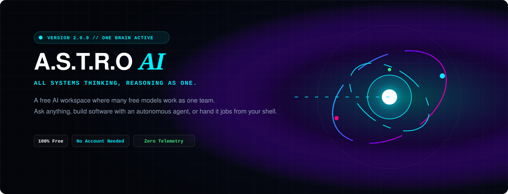
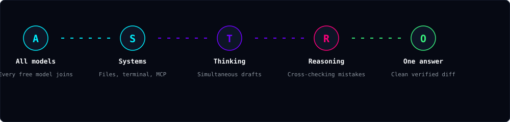

<div align="center">
  <a href="https://esoexe.github.io/astro-ai/">
    
  </a>
</div>

<p align="center">
  <strong>All Systems Thinking, Reasoning as One.</strong><br>
  A free AI workspace where many free models work as one team. One brain, many minds.
</p>

<p align="center">
  <a href="https://github.com/esoexe/astro-ai/releases"></a>
  <a href="LICENSE"></a>
  
  
  
</p>

---

## 01 / What It's For

One app for the things people use AI for every day, with a whole team of free models behind every answer. No subscription, no sign-in.

* **Ask & learn:** Questions, explanations, research, writing and maths. Many models draft, check each other, and you get one clear answer. Talk to it with the live voice button.
* **Build software:** Open a folder. The agent reads your code, plans, writes, runs the tests and shows you a diff. You choose `Plan`, `Ask` or `Auto`, and every run can be undone.
* **Automate from the terminal:** The `astro` command brings the same agent to your shell, scripts and CI. One task, a live session, or JSON output for your own tools.
* **Run many jobs at once:** Start up to eight agents in parallel. Each one works in its own isolated copy of the project, so they never step on each other. Merge what you like.
* **Plug it into your tools:** A VS Code extension, a JavaScript SDK, an OpenAI-compatible API, and full support for your Claude Code, Cursor and OpenCode rules, skills and MCP servers.

---

## 02 / How It Works: Five Letters, One Idea

The name is the method. Every question and every coding job goes through the same five steps:

<div align="center">
  
</div>

1. **A — All models:** Every free model you have access to joins in, including the slow ones. When one provider hits a rate limit, the rest of the team carries on.
2. **S — Systems:** The team can use real tools: your files, a terminal, web search, a code runner, MCP servers and custom skills.
3. **T — Thinking:** Each model works on its own draft or plan at the same time, so you see different approaches, not one guess.
4. **R — Reasoning:** The drafts are compared and reviewed. A mistake one model makes is caught by another.
5. **O — One answer:** You get one clear answer, or one finished change with a diff.

---

## 03 / The Whole Team, In Your Terminal

Type `astro` in any folder to open a full-screen app in the spirit of Claude Code and OpenCode: a calm conversation view, a side panel you can toggle, approvals right in the terminal, a model picker and parallel agents.

```bash
# Open the full-screen terminal app in current folder
astro

# Run a one-shot task and print the report
astro -p "Fix the failing test in server.js"

# Run several agents in parallel on isolated copies
astro parallel "Add login test" "Document endpoints"

# Review changes, bring them in, or take them back
astro diff
astro merge
astro undo
