<div align="center">
  <a href="https://esoexe.github.io/astro-ai/">
    
  </a>
</div>

<p align="center">
  <strong>The sovereign autonomous developer workspace powered by One Brain neural synchrony.</strong><br>
  Built in ISO C++20 · Zero Python runtime overhead · Native Model Context Protocol (MCP) client.
</p>

<p align="center">
  <a href="https://github.com/esoexe/astro-ai/releases"></a>
  <a href="LICENSE"></a>
  
  
  
</p>

---

### Quick Installation

Run the automated installer for your platform:

```bash
# macOS and Linux
curl -fsSL https://esoexe.github.io/astro-ai/install.sh | bash

# Windows (PowerShell)
iwr -useb https://esoexe.github.io/astro-ai/install.ps1 | iex
