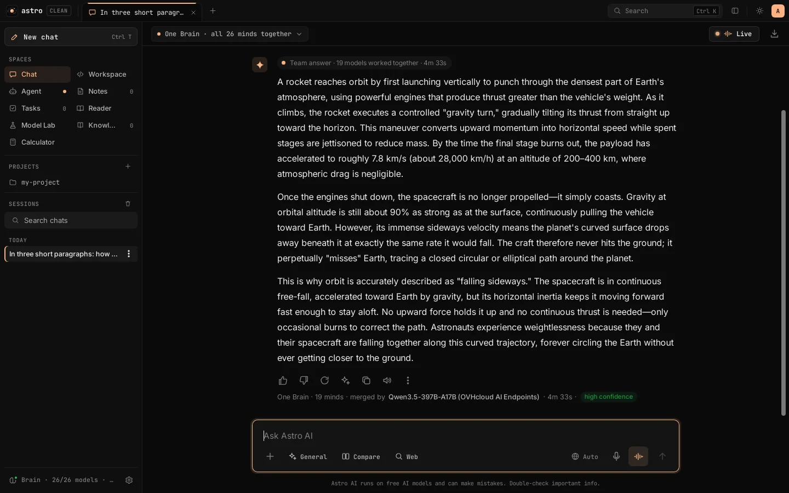

<p align="center"></p>

<h1 align="center">Astro AI</h1>
<p align="center"><b>One brain, many minds.</b> A free desktop app where a team of free AI models answers as one.</p>
<p align="center"><a href="https://esoexe.github.io/astro-ai/">Website</a> · <a href="https://esoexe.github.io/astro-ai/download.html">Download</a> · <a href="https://esoexe.github.io/astro-ai/docs.html">Docs</a> · <a href="https://esoexe.github.io/astro-ai/api.html">Astro API</a> · <a href="https://esoexe.github.io/astro-ai/changelog.html">Changelog</a></p>

<p align="center"><a href="https://esoexe.github.io/astro-ai/#trailer"></a><br><sub>▶ <a href="https://esoexe.github.io/astro-ai/#trailer">Watch the 90-second trailer</a> (real app footage) · <a href="https://esoexe.github.io/astro-ai/assets/video/astro-ai-trailer.mp4">MP4</a><br>Music: “Clean Soul” by Kevin MacLeod (incompetech.com), CC BY 4.0</sub></p>

<p align="center"></p>

> **Downloads:** Windows, Linux and macOS builds are on the [download page](https://esoexe.github.io/astro-ai/download.html). They are the *Clean* edition and ship with no API keys.

## About

**Astro AI** is an omni workspace: chat, research, read, test and act, powered by **One Brain**, where many free AI models think at the same time and one of them merges their answers.

- **Backend:** C++20 with POSIX sockets, libcurl and OpenSSL. No Python, and no Node at runtime.
- **Frontend:** plain HTML, CSS and JS that you can install as an app (PWA).
- **Providers:** 53 free AI platforms registered in `providers.json`, including **Atria AI** (Atria Dawn, 744B). **4 work with no key at all** (OVHcloud, Kilo Gateway, LLM7, Pollinations, about 26 models). The rest connect with your own free key, pasted in **Settings → Providers & keys**.

> Free tiers have rate and daily limits, can change or end at any time, and some log or train on prompts (flagged "may train" in the app). Astro AI never bypasses limits. When a provider is busy or out of quota, it switches to another one.

## What you can do

| Area | Features |
|---|---|
| **Chat** | Modes: General, Writing, Tutor, Code, Plan, Research. Response language: Auto, English, French or Arabic. Compare two models. Keep several drafts, rewrite answers, export to Markdown. |
| **One Brain** | 3, 4, 6, 8 or **All** models answer in parallel over one multiplexed stream; one model merges the answers. You get a **fast first answer** while the others finish, a **confidence badge** (high/medium/low), and per-provider concurrency caps. |
| **Web** | Turn on **Web** in the composer: the server searches (Tavily or Brave API key if you add one, otherwise Brave's public results, DuckDuckGo and Wikipedia), reads the top pages, and answers with numbered **[n] citations** and source chips. Links you paste in a message are read automatically. |
| **Reader** | Open any public web page or file (PDF, DOCX, code, text) as clean text, then Summarize, Ask about it, Save as note, Read aloud or Add to knowledge. |
| **Model Lab** | Send one prompt to any set of models (fastest 4, 8, all ready, or hand-picked), compare speed and answers side by side, and export the results. |
| **Run code** | HTML, JS, CSS and SVG code blocks get a **Run** button: the code runs in a sandboxed iframe with no access to your data. |
| **Images** | Attach or paste an image. A free vision model (e.g. Qwen2.5-VL-72B on OVH, no key) describes it, and the brain answers using that description. |
| **Agent** | The AI can create, append and delete notes; manage tasks; set reminders; remember and forget facts; search the web; read URLs; create files (downloads); open the Reader; calculate exactly; and change settings. Undo and Confirm cards for every action. |
| **Live voice** | Real-time spoken conversation with barge-in (browser speech). |
| **Workspace** | Notes, Tasks, reminders, Knowledge files (TXT, MD, CSV, JSON, HTML, XML, DOCX, PDF and 30+ code formats), an exact calculator, and a command palette (Ctrl K). |
| **Library** | Workspace → Extensions → Library, and on the website at [/profile#/library](https://esoexe.github.io/astro-ai/profile#/library). Every server in the official MCP Registry, thousands of agent skills and Claude Code plugins from public GitHub repos, AI command-line tools from npm and PyPI, and a directory of AI apps. Rebuilt daily. One-click install with pinned versions, SHA-256-checked files and no hooks or binaries. Items the Astro AI team checked are marked **Reviewed**; everything else is labelled **Community** with its source. See [docs/library.md](docs/library.md). |
| **Account** | Password login (PBKDF2-SHA256, 210k iterations; 30-day sessions; lockout after repeated failures). Change your password or sign out in Settings → Account & sync. |
| **Sync** | Chats, notes, tasks, memory and reminders are saved on your server (`astro_data/store.json`), mirrored to your Supabase table `astro_store`, and loaded on any device where you sign in. |
| **Usage meter** | Requests, successes, rate limits and average speed per provider today (UTC). One-click **Test** per provider, or **Test all connected**. |
| **Install** | Installable PWA with an offline app shell (notes and tasks work offline). Reminders use system notifications. |

## Run it

```bash
make                       # builds ./workspace_server (needs g++, libcurl and OpenSSL dev packages)
PORT=8080 ./start_workspace.sh
# open http://localhost:8080 and create your password
```

- **Docker (any VPS or home server):** `docker build -t astro-ai . && docker run -d -p 8080:8080 -v astro-data:/data astro-ai`. The image includes `pdftotext` for PDF reading.
- **Tests:** `make test` runs the smoke tests: the core features, the Astro AI extensions, SSRF blocking, sync conflict handling, and the login flow on a second instance.

### Environment

| Variable | Purpose |
|---|---|
| `PORT` | Listening port (default 8080) |
| `ASTRO_DATA_DIR` | Where the password hash, sessions, saved keys, usage and sync copy are kept (the start script uses the project folder with mode-600 files; Docker uses `/data`) |
| `ASTRO_PASSWORD` | Optional: sets the first password without the setup screen |
| `ASTRO_AUTH=off` | Disables login (only for local testing) |
| `<PROVIDER>_API_KEY` | Any key from `providers.json`, for example `ATRIA_API_KEY`, `GROQ_API_KEY`, `GEMINI_API_KEY` or `HF_TOKEN`. Keys saved in Settings override environment and gateway keys. |
| `TAVILY_API_KEY`, `BRAVE_API_KEY` | Optional: steadier web search |
| `LLM_CREDENTIALS_URL` + `LLM_API_KEY` | Optional: the Supabase gateway hand-off (keys in Supabase secrets, memory only) and sync mirror |
| `DISABLE_PROVIDER_<id>`, `MAX_MODELS_PER_PROVIDER`, `AUTO_MAX_ATTEMPTS` | Brain tuning |

## Design: "Orbit"

The interface uses one neutral surface palette with a single teal accent. Light and dark themes are both included: use the sun/moon button in the top bar, or **Settings → General → Theme**.

- **Dock:** a slim floating dock on the left holds the logo, **New chat**, chat history, search, every page (Chat, Workspace, Agent, Notes, Tasks, Reader, Model Lab, Knowledge, Calculator), Brain status and Settings.
- **Chat history:** a "Recent" card beside the dock on the Chat page. Toggle it with the history button or **Ctrl+B**. It stays open on wide screens and slides over the page on narrower ones.
- **Command pill:** the "Search or jump to… Ctrl K" pill in the top bar opens the command palette, which searches chats, models and actions.
- **Home:** an animated orbit mark, a time-of-day greeting with your name, suggestion chips, and a launchpad with shortcuts to Agent, Workspace, Notes and Reader.
- **Type:** Inter for the interface, Instrument Serif for headings and the greeting, JetBrains Mono for code, editor and terminal. All three are bundled in `web/vendor/` (SIL OFL, see `FONTS-LICENSE.txt`), so the app works offline.
- **Mobile:** the dock becomes a slide-in drawer (menu button, top left), the chat fills the screen, and the launchpad becomes a 2×2 grid.
- **Code:** the design layer is `web/orbit.css`, loaded after `styles.css`. Its colour tokens are at the top of the file.

## Desktop app (Windows, Linux, macOS)

A native desktop version with an **OpenCode Desktop-style layout**. It has session tabs in the title bar, a flat sidebar (Spaces, Projects, Sessions) and a review-panel toggle, in a near-black theme with a peach accent and mono UI text. The light theme is available too. It uses the system webview (WebView2, WebKitGTK or WKWebView) plus the same C++ server, bound to `127.0.0.1` only. There is no Electron, Python or Node at runtime. The web version is unchanged; open `/?desktop=1` to preview the desktop shell in a browser.

**Two editions** (built into `desktop-builds/`):

| Folder | App name | API keys | Data folder | Port |
|---|---|---|---|---|
| `with-keys/` | Astro AI | **Contains your keys** (`seed-keys.env`, `gateway.env`). Keep it private. | `%APPDATA%\Astro AI`, `~/.local/share/astro-ai`, `~/Library/Application Support/Astro AI` | 47611 |
| `clean/` | Astro AI Clean | **None.** Starts fresh; add keys in Settings > Keys. Safe to share. | `…\Astro AI Clean`, `~/.local/share/astro-ai-clean` | 47612 |

Both editions can be installed side by side. Their names, folders, data, ports and webview storage are all separate.

**Files for each edition:**
- **Windows x64:** a custom `Setup` installer (per-user, no admin; installs WebView2 if it's missing) and a portable `.zip`. The installer is Astro AI's own: a hand-drawn window where the moon's trip around the orbit is the progress bar, with a matching uninstaller. Silent use: `Setup.exe /S [/D=folder]`, `Uninstall.exe /S [--purge]`.
- **Linux:** a `.deb` and a portable `.tar.gz` (glibc 2.35+, WebKitGTK 4.1).
- **macOS:** a source kit. Run `./build_mac.sh` on a Mac to get a universal `.app` and `.dmg`.

**Keyboard shortcuts:** Ctrl+T new session, Ctrl+W close tab, Ctrl+Tab next tab, Ctrl+1…9 jump to a tab, Ctrl+B sidebar, Ctrl+Shift+E review panel, Ctrl+K search.

**Desktop behaviour:**
- External links open in your normal browser.
- Exports and downloads are saved to your Downloads folder.
- The server restarts itself if it crashes and stops when the window closes.

**Rebuild:** run `desktop/package.sh`. It needs mingw-w64, zip, libwebkit2gtk-4.1-dev, libcurl and libssl.

**Source files:**
- `desktop/src/astro_desktop.cpp`: the launcher.
- `web/desktop.js` and `web/desktop.css`: the desktop shell.
- `platform.h`: OS layer, including ConPTY on Windows.
- `desktop/setup/`: the custom Windows installer (C++ / GDI+, `build_setup.sh`, bundled OFL fonts). `desktop/mac/build_mac.sh`: Mac build. (`desktop/installer/astro.nsi` is the old NSIS script, no longer used.)

**Notes:**
- On Windows, running code and terminal commands in the Workspace or Agent needs Git for Windows, which provides bash.
- Voice dictation depends on the webview. WebKitGTK on Linux has no speech recognition.

## Workspace IDE

The Workspace is a full code editor and runner inside Astro AI:

- **Editor**: CodeMirror 6 with syntax highlighting for 20+ languages, autocomplete (Ctrl+Space), code folding, multiple cursors (Ctrl+D), find and replace (Ctrl+F / Ctrl+H), go to line (Ctrl+G), word wrap (Alt+Z) and undo history per file. If the bundle can't load, it falls back to the simple editor.
- **Sidebar**: Files (drag and drop files *or whole folders*, upload a folder, download the project as a ZIP), Search (every file, with match case / whole word / regex, and Replace all with one-click undo), and History.
- **Versions**: a version is saved automatically before every AI change, Replace all and restore. You can also save versions yourself, compare any version with the current files as a unified or side-by-side diff, and restore one file or the whole project.
- **AI team**: every change card shows +/- line counts, **Review changes** (diff) and **Undo/Redo**. The team can build multi-file projects, delete files (`DELETE: path`), and use npm or pip packages (`npm install` / `pip install -r requirements.txt` run automatically). With **Auto-fix** on, a failed run, server start or page console error goes back to the team, which fixes it (up to 2 tries).
- **Run**: Run (output below), Run in terminal (interactive input), Run as server, npm start, and Install dependencies. Files that start a web server (Express, Node http, Flask, FastAPI…) are detected and kept running. Their pages show live in Preview through `/app/<key>/<project>/`, and the logs appear in the Server tab.
- **Terminal**: a real interactive shell (xterm.js + a PTY on the server), opened in the project folder.
- **Console**: console.log output and errors from the previewed page appear under Preview, with an **Ask team to fix** button.

### Workspace intelligence

- **Engineering persona**: in the Workspace, the team answers as a direct, spec-driven engineer. It writes complete files with no "rest of code here" gaps, keeps an eye on CPU and memory cost, and reports what it built and how it checked it.
- **Context engine**: before every task the team gets a repo index (`POST /api/ide/index`: symbols, imports and dependencies for C/C++, Python, JS/TS, Go, Rust, Java, C# and more), the open file, recent errors and the project memory. The **Context** tab shows the index stats, the outline of the current file (click a symbol to jump to it) and the memory.
- **Project memory**: `.workspace/memory.md` holds architecture decisions and conventions. You can edit it in the Context tab, and the team adds lines itself (`MEMORY: …`) when you ask it to remember something.
- **Knowledge map**: an interactive graph of files and their imports (Context → Map). Click a node to see its symbols and links; double-click to open the file.
- **Plan mode**: the **Plan** toggle makes the team write a numbered step plan first. Each step then runs as its own build-run-check turn, with done or failed marks and self-healing (Auto-fix) per step.
- **Git**: a Git tab with init, status, branches (create and switch), a per-file diff review, commit and log (`POST /api/ide/git`). **Draft** has the AI write a Conventional Commit message from the diff.
- **Profiling and assembly**: every run reports wall time, CPU time and peak RAM (`astro_measure`). **Optimize** sends the stats to the team. Run ▸ *Show assembly* prints the optimized `-O2` Intel-syntax assembly of a C or C++ file.
- **Clickable errors**: compiler and runtime locations (`file:line:col`) in the output jump to the line in the editor.
- **Languages**: C, C++, Python, JavaScript, **TypeScript** (run with `npx tsx`, which needs npm access the first time), Java, Go, Rust, shell and more. C# needs a .NET SDK, which this server doesn't have.
- **3D / WebGL**: three.js (r186) and OrbitControls are bundled locally. Pages import them with `<script type="importmap">{"imports":{"three":"/vendor/three.module.min.js","three/addons/controls/OrbitControls.js":"/vendor/OrbitControls.js"}}</script>`.
- The preview serves files with CORS, so ES-module scripts (`<script type="module" src="app.js">`) load inside the sandboxed preview.

The editor bundle is built from `tools/ide-vendor` (`npm install && npm run build` → `web/vendor/ide.js`, `web/vendor/xterm.css`, `web/vendor/three.module.min.js`, `web/vendor/OrbitControls.js`). Tests: `tests/ide_api_test.sh`, `tests/ide_proc_test.js`, `tests/intel_api_test.sh`, and the browser tests `tests/ide_ui_test.js` and `tests/intel_ui_test.js` (need puppeteer-core and Chrome).

## Agent mode

The **Agent** works on its own, like Arena.ai's Agent Mode. You give it a job and it acts in a loop: run shell commands, read, write and edit files, list and search the project, search the web, read pages, start a server and read its logs, remember facts, and ask you a question when it is truly stuck. It keeps going until the job is done and checked, then writes a short report.

- **Hybrid brain**: the whole team of models (every connected model) plans and reviews the work. One fast model carries out the steps, and if it fails another model takes over. The team plans **at the same time** as the agent starts working, and the plan is handed to the agent the moment it is ready, so a slow team never blocks the work. At the end the team reviews the changed files. If it answers `VERDICT: FIX`, the agent gets one fix round. Pressing ■ during the review skips it and keeps the finished work. You can turn team planning and review off with the **Team plan & review** chip.
- **Full auto, fully logged**: no approval prompts. Every step is shown in the timeline: what the agent said, every tool call with its input and output, exit codes, timings and the model that wrote each step. A version (checkpoint) is saved before the first change, and **Undo all changes** puts the whole project back.
- **Agent page** (sidebar → Agent), an OpenCode-style layout:
  - **Left**: the project picker and the session list. Sessions are saved on the server in `data/.astro_agent/<project>/`, outside the project folder.
  - **Centre**: the timeline and the job box.
  - **Right**: **Changes** (every file added, modified or deleted since the session started, each with a diff), **Files** (the project tree), **Terminal** (every command the agent ran in order, plus a box to run your own) and **Preview** (the server the agent started).
- **Workspace Agent mode**: the team panel in the Workspace has a **Team / Fast / Agent** switch. In Agent mode the same agent runs in the panel, the editor and file tree update live as it works, and ⤢ opens the session in the full Agent page.
- **Limits**: up to 40 steps per run (press **Continue** to go on), up to 6 tool calls per step, and commands time out after 120 s by default (up to 900 s). Long-running servers are started with `start_server` (the managed server process), not with `&`.
- **APIs**:
  - `POST /api/ide/exec {project, command, timeout?, cwd?}` returns `{code, out, ms, timed_out, truncated}`.
  - `POST /api/ide/proc/tail` returns the server status and the end of its log.
  - `POST /api/ide/agent/list | load | save | delete` manage sessions.
- **Tests**: `tests/agent_ui_test.js` and `tests/agent_ws_test.js` (browser tests that run real agent jobs). Example: `BASE=http://127.0.0.1:4096 TEAM=0 node tests/agent_ui_test.js`.

## Terminal app and parallel agents

`astro` runs the Astro AI agent in your terminal:

```bash
cd my-project && astro                                   # interactive
astro -p "fix the failing test" --json                    # scripts and CI
astro parallel "add dark mode" "write tests" --merge      # several agents, each in an isolated copy
astro agents · astro diff <id> · astro merge <id> · astro undo <id>
```

Agents run in the server's **agent engine**, not in the browser tab, so they keep going when you close the window. Up to 8 run at once. With **isolate**, each agent works in a git worktree, or in a copy of the folder, which you review and then merge or discard. Merging stops when a file was also changed in the project after the agent started. In the app, the same engine is the **Parallel** chip on the Agent page. The desktop installers include `astro`. From source, run `make astro`. See [docs/cli.md](docs/cli.md), which also documents the `/api/agent/*` HTTP API.

## Free providers

The list is in `providers.json` (regenerate it with `node tools/build_providers.js`). Settings → Providers & keys shows each platform's limits, privacy notes, sign-up link, key field and today's usage.

| Group | Platforms |
|---|---|
| **No key needed** | OVHcloud AI Endpoints, Kilo Gateway, LLM7, Pollinations |
| **Free key (sign up)** | **Atria AI**, Groq, Google Gemini, Cerebras, NVIDIA, OpenRouter, Mistral, Cohere, Cloudflare Workers AI, Z.ai, Ollama Cloud, Hugging Face, ElectronHub, xKiro, ACLIDE, DreamPrompting, Waterfall, NaraRouter, Routeway, Requesty, Agnes, SEA-LION, Router9, Septor, Aion, CLōD, Speka, BazaarLink, UnoRouter, AMD Radeon, Logfare, AnyAPI, AINative, OrcaRouter, NavyAI, LongCat, Experiential, Kenari, SiliconFlow, B.AI, Free.ai, OpenCode Zen, Api.Airforce |
| **Real-name verification (China)** | ModelScope, Baidu Qianfan, Volcengine, iFlytek |
| **Local** | llama.cpp (Qwen 2.5 1.5B) as the last fallback |

**Atria AI:**
1. Sign in with Google at https://api.atria-asi.ai/console/keys.
2. Create a key (`atr_…`).
3. Paste it as `ATRIA_API_KEY`.

Model: `Atria-Dawn` (text, 256K context, free preview with tightened quotas).

## Security notes

- Every `/api` route except `/api/auth/*` requires a session token. Keys are stored server-side (file mode 0600) and are never returned to browsers.
- The web reader blocks private, loopback, link-local and metadata addresses (it checks every resolved IP and every redirect), and caps download size.
- Static files are served only from `web/` with an extension allow-list.
- Run code executes only in a sandboxed iframe (`allow-scripts`, no same-origin access).
- The Supabase table `astro_store` has row-level security with no policies, so only the Edge Function (service role, behind your proxy token) can use it.
- Put Astro AI behind HTTPS (Caddy, Nginx or Cloudflare Tunnel) when it is on the internet.

## Advanced setups

### Live AI with a free local model (no API key)

`start_local_ai.sh` downloads a prebuilt **llama.cpp** server (C++) and **Qwen2.5-1.5B-Instruct** (Q4_K_M, about 1.1 GB, Apache-2.0). It then serves the model at `127.0.0.1:8081` (internal only) with an OpenAI-compatible API. Run it in one terminal, then start Astro AI in another:

```bash
./start_local_ai.sh
PORT=8080 LLM_BASE_URL=http://127.0.0.1:8081/v1 LLM_MODEL=qwen2.5-1.5b-instruct LLM_MAX_TOKENS=768 ./workspace_server
```

Answers stream token by token (`/api/chat/stream`, Server-Sent Events). The send button becomes **Stop** while an answer is generating, and stopping cancels generation on the model server. The model runs on the machine where you start it. A 1.5B model is fast on CPUs and handles English, French, and Arabic, but it is much less capable than large hosted models. It can make mistakes, especially on facts, maths, and long reasoning.

`LLM_MAX_TOKENS` caps the length of each answer (default 1024).


### Hosted DeepSeek V4.1 Flash through Supabase (free tier)

The large DeepSeek models can't run on Supabase or on a small machine. DeepSeek-V4.1-Flash has 552B parameters, and even its compressed local build is about 114 GB. Instead, Astro AI can use **NVIDIA's free developer endpoint**, which serves `deepseek-ai/deepseek-v4.1-flash` on NVIDIA's GPUs. A small **Supabase Edge Function** (`supabase/functions/workspace-ai`) sits in between:

```text
startup:  Astro AI (C++) ──proxy token──▶ Supabase Edge Function /credentials ──▶ {base_url, model, NVIDIA key}
chat:     Browser ──▶ Astro AI (C++) ──key held in memory──▶ NVIDIA (DeepSeek V4.1 Flash)
                                │ no answer within LLM_WAIT_SECONDS (default 150 s), or an error?
                                └──▶ local Qwen model on 127.0.0.1:8081 answers instead (with a note)
```

- The NVIDIA key is stored only as a Supabase secret (`NVIDIA_API_KEY`). The C++ server fetches it once at startup through `POST …/workspace-ai/credentials`, which needs `WORKSPACE_PROXY_TOKEN`. It keeps the key in memory only: the key is never written to disk, logged, or sent to the browser.
- Why chat requests no longer go through the Edge Function: Supabase stops a function after 150 s (HTTP 546 `WORKER_RESOURCE_LIMIT`), and NVIDIA's free queue can wait longer than that before answering. The `/chat/completions` relay still exists and is used automatically if fetching the credentials fails.
- **Fallback:** `start_workspace.sh` sets `FALLBACK_BASE_URL`/`FALLBACK_MODEL` when the local model (`./start_local_ai.sh`) is running. If DeepSeek errors or sends nothing for `LLM_WAIT_SECONDS`, the local model answers. Its reply starts with a short italic note saying so. Pressing Stop cancels right away, even while the request is still queued.
- Setup: create a free key at build.nvidia.com (open the DeepSeek V4.1 Flash model page → Get API Key). Then add it in **Supabase dashboard → Edge Functions → Secrets** as `NVIDIA_API_KEY`.
- Run `./start_workspace.sh`. It reads the private `.workspace.env` file (gateway URL, proxy token, model label, and optionally `LLM_WAIT_SECONDS`). Use `USE_LOCAL_MODEL=1 ./start_workspace.sh` to switch back to the local model.
- NVIDIA's free tier is for development and prototyping. It is rate-limited (roughly 40 requests/minute), and NVIDIA can change its availability or terms. Prompts go to NVIDIA; review its terms before sending sensitive data.
- Optional secret `UPSTREAM_EXTRA_BODY` lets you pass provider-specific switches. `UPSTREAM_BASE_URL` and `UPSTREAM_MODEL` let you point the gateway at another OpenAI-compatible provider, such as DeepSeek's paid API (`https://api.deepseek.com`, model `deepseek-flash`).


### OpenCode layer (free OpenCode models + your OpenCode key)

Astro AI can use the models served through **OpenCode** by running the official `opencode serve` (the "OpenCode layer") locally on `127.0.0.1:4097`. Astro AI controls it through OpenCode's documented HTTP API. It doesn't imitate OpenCode or call OpenCode's endpoints directly.

```text
Browser ─▶ Astro AI (C++) ─▶ opencode serve (127.0.0.1:4097, all tools disabled) ─▶ OpenCode models
                   │ blocked / failed / no answer?
                   ├─▶ DeepSeek V4.1 Flash on NVIDIA free (direct, key held in memory)
                   └─▶ local Qwen model (127.0.0.1:8081)
```

- Start: `./start_opencode.sh`, then `./start_workspace.sh`. The OpenCode launcher installs OpenCode into `.cache/opencode` if it's missing. It then fetches `OPENCODE_API_KEY` from the Supabase secret (via `/credentials`) into memory only.
- The **MODEL** picker in the top bar offers *Auto* (tries every route in order) or a specific model. The others stay as automatic fallbacks. Routes that fail are remembered and skipped: the free pool until its reset time, other routes for 10 minutes. The answer starts with a short note saying which model answered and why.
- The OpenCode models are set in `providers.json` (`opencode` = free models, `opencode-paid` = your key). The defaults are `deepseek-v4.1-flash-free` and `glm-5.3-flash-free`, which both have zero-retention providers. Other free models (Big Pickle, MiMo, Nemotron, Flint) may use your chats for training, so they aren't in the default list.
- Safety: `opencode_layer/opencode.json` defines a `chat` agent with **all tools disabled**, so it has no file, shell or web access. The server is password-protected (`OPENCODE_SERVER_PASSWORD` in `.workspace.env`) and listens only on localhost. Background title generation uses the local model, so it never calls a paid model.
- **Auto order:** see "The brain" below. A model you pick in the MODEL menu is always tried first, even if it was marked unavailable.
- The OpenCode free limit seems to be counted per internet address. On a shared cloud server it may already be used up by other people. On your own computer, the free models are more likely to work until the daily cap.
- **Limits (tested 2026-10-26):** OpenCode's free models are *free for a limited time* and have a **daily usage limit** that resets at 00:00 UTC ("Free usage limit reached … subscribe to OpenCode Go"). They aren't unlimited or permanent.
- **Your OpenCode key:** pay-as-you-go models need credits on the account (otherwise you get "Insufficient account funds"). OpenCode Go models need a Go subscription ($10/month).
- Resources: OpenCode uses about 420 MB of RAM. The models themselves run on the providers' servers.


### Connect a hosted model

Set these variables in the **server environment** before starting Astro AI. Use a model ID supported by your provider:

```bash
export LLM_BASE_URL="https://api.your-provider.com/v1"
export LLM_API_KEY="your-secret-key"
export LLM_MODEL="your-provider-model-id"
./workspace_server
```

Requests are sent to `LLM_BASE_URL/chat/completions` using the OpenAI-compatible format. If the URL already ends in `/chat/completions`, it is used as-is. Keep API keys server-side—Astro AI never asks for or stores them in the browser. Use **Astro AI settings → Test connection** after configuring it.

For a local OpenAI-compatible model server:

```bash
export LLM_BASE_URL="http://127.0.0.1:11434/v1"
export LLM_API_KEY=""
export LLM_MODEL="your-local-model-name"
./workspace_server
```

The local model server must be running and expose a compatible `/chat/completions` endpoint. `.env.example` is a reference template only; the app does not load `.env` files automatically.


## Project files

| Path | Contents |
|---|---|
| `workspace_server.cpp` | HTTP server, JSON, streaming, brain routing, providers, documents, calculator |
| `astro_engine.inc` | Agent engine: background and parallel agents, isolated copies, merge and undo, `/api/agent/*` |
| `cli/astro.cpp`, `cli/json.h` | The terminal app `astro` |
| `astro_ext.inc` | Login, keys, usage, web search and reader (SSRF-safe), vision, sync, static files |
| `web/` | `index.html`, `styles.css`, `orbit.css` (Orbit design layer), `app.js`, `sw.js`, `manifest.webmanifest`, `icon.svg`, `vendor/` (libraries and fonts) |
| `providers.json`, `tools/build_providers.js`, `tools/free_catalog.json` | Provider registry and generator |
| `supabase/functions/workspace-ai/index.ts` | Gateway v10: key hand-off, `/store` sync, relay |
| `supabase/migrations/20261026_astro_store.sql` | Sync table |
| `Dockerfile`, `start_*.sh`, `tests/smoke_cpp.sh` | Deploy, run and test |

## Website

The official Astro AI website lives in `website/`: static HTML, CSS and JS with no dependencies.
`node website/build.js` builds it into `website/dist/`, the folder you deploy (Netlify, Cloudflare Pages, Vercel or GitHub Pages).
Only the CLEAN desktop builds are copied into the site, and the build refuses to publish anything from the WITH-KEYS edition.
See `website/README.md` for deploy steps. Set your domain in `website/site.json` first.

## License

Astro AI is available under your choice of the **MIT**, **Apache-2.0** or **GPL-3.0** license; see [LICENSE](LICENSE). Bundled third-party components keep their own licenses; see [THIRD-PARTY-NOTICES.md](THIRD-PARTY-NOTICES.md).
